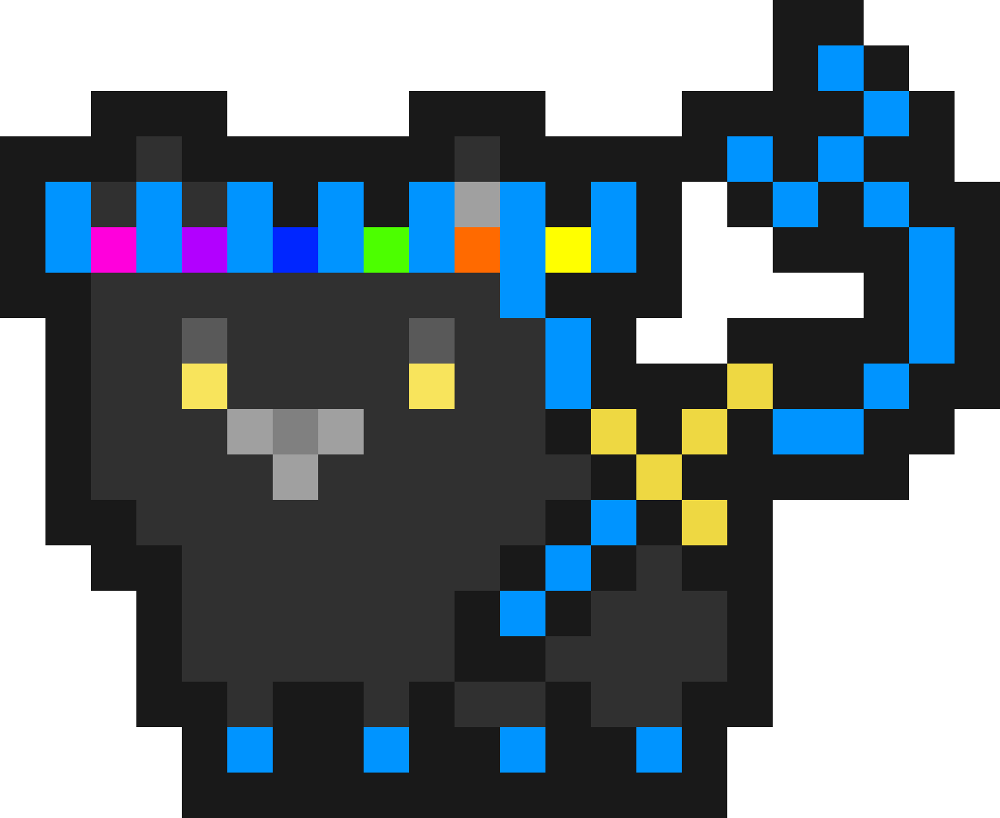
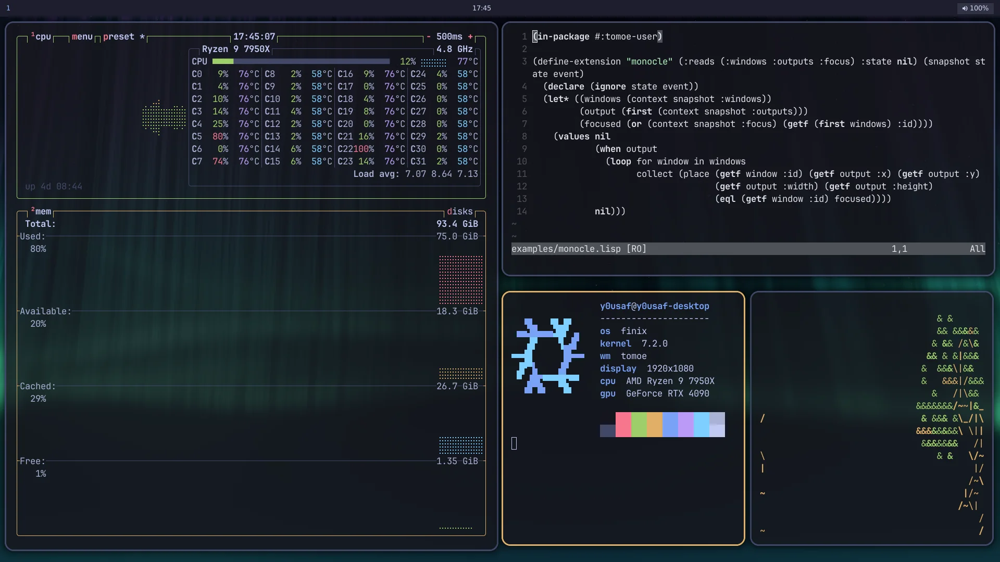
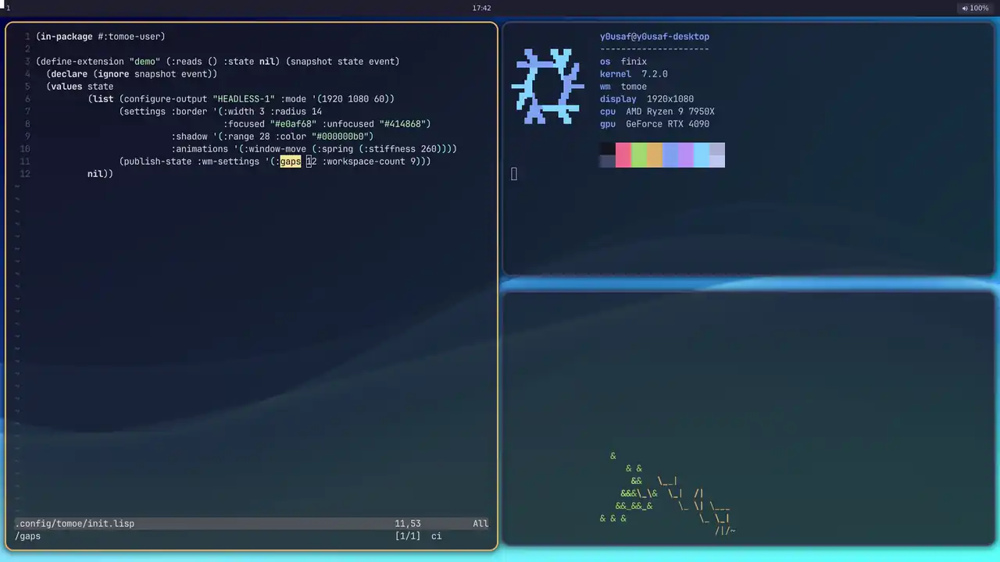

<p align="center"></p>
<br clear="both">

**Tomoe** (巴, after Tomoe, my beloved cat) is a Wayland compositor whose
window manager, bar and wallpaper are Lisp you can rewrite while it runs, in a
Common Lisp dialect that Tomoe's own C core carries.

It is not a desktop environment. It won't log you in, start your system
services or hide its decisions behind a settings app. You start it from a
terminal, it leaves systemd alone, and every choice it makes is a Lisp file you
can read, replace or delete.

<p align="center"></p>

## Why you might like it

- **Your desktop is a program.** Tiling, keybindings, the bar, the wallpaper
  picker: each is a small extension. The shipped window manager uses the same
  public API your config does, and Tomoe has no special case for it.
- **Change it while it runs.** Save a file and Tomoe picks it up within
  half a second. Mount a different window manager, try it, unmount it:
  your windows stay open the whole time.
- **Mistakes don't take you down.** A file that fails to load leaves the last
  good version running and tells you what broke. `--bare` starts with no policy
  at all and is still a working compositor.
- **Unmount means gone.** An extension owns what it declares: placements,
  bindings, panels, processes, watched files. Unmount it and all of that goes
  with it, sockets included. A service also dies with the compositor when it is
  killed, and the next start clears what a dead session left.
- **One executable.** Tomoe's own C core for Wayland, rendering and input, with
  its Lisp built in; no wlroots and no separate Lisp implementation. It has a built-in X11 bridge (Xwayland from your `PATH`),
  a notification server and a screencast portal.

## Try it

You need Linux 6.9 or newer and [Nix](https://nixos.org/download) with flakes.

```sh
nix run github:y0usaf/tomoe
```

Inside another Wayland session Tomoe opens as a window, which is the easiest
way to look around. From a TTY it takes over the screen. The first run builds
Tomoe and a few patched dependencies, so give it a while.

| Keys | What they do |
| --- | --- |
| Super+j, Super+k | Focus the next or previous window |
| Super+f | Toggle fullscreen |
| Super+1 … 9 | Switch workspace |
| Super+Shift+1 … 9 | Send the focused window to a workspace |
| Super+q | Close the focused window |
| Super+drag | Move a window with the left button, resize it with the right |
| Super+Shift+/ | Show every binding |
| Super+Shift+e | Quit, after asking |

The default layout tiles each workspace by halving the remaining space, with
an eight-pixel gap.

## Make it yours

Tomoe loads `~/.config/tomoe/init.lisp` at startup and reloads it whenever you
save. An extension is one function: it receives a snapshot of the desktop, its
own state and the event that woke it, and returns its new state and the effects
it wants. This one rounds the corners and widens the gaps:

```lisp
(in-package #:tomoe-user)

(define-extension "look" (:reads ()) (snapshot state event)
  (declare (ignore snapshot event))
  (values state
          (list (settings :border '(:radius 10 :focused "#89b4fa"))
                (publish-state :wm-settings '(:gaps 16)))
          nil))
```

An extension keeps whatever must outlast one event in its state. A reducer that
assigns a global, or stores an event's data into a list, table or closure its
source made when it loaded, fails like any other broken extension, because that
data is gone once the event is handled.

Change a number, save, and the windows move:

<p align="center"></p>

A whole window manager fits on a screen. This is
[`examples/monocle.lisp`](examples/monocle.lisp), which shows only the focused
window:

```lisp
(in-package #:tomoe-user)

(define-extension "monocle" (:reads (:windows :outputs :focus) :state nil) (snapshot state event)
  (declare (ignore state event))
  (let* ((windows (context snapshot :windows))
         (output (first (context snapshot :outputs)))
         (focused (or (context snapshot :focus) (getf (first windows) :id))))
    (values nil
            (when output
              (loop for window in windows
                    collect (place (getf window :id) (getf output :x) (getf output :y)
                                   (getf output :width) (getf output :height)
                                   (eql (getf window :id) focused))))
            nil)))
```

Terminals that Tomoe starts have `tomoe` on their `PATH`, and it talks to the
running compositor. From a checkout of this repository, put monocle on top of
the tiling, then take it away again:

```sh
tomoe mount "$PWD/examples/monocle.lisp"
tomoe unmount monocle
```

No window restarts. `tomoe inspect` prints everything the compositor knows,
from windows and outputs to each extension's state and last error.

`tomoe frames` prints each output's frame counters, what a composition costs it
(`:cost-ns`), the vblanks it missed (`:missed`) and its frame clock, and
`tomoe memory` the heap and buffer use. `:fragments` is how many pixels the frame's
scene draws covered, so a change that stops painting what something else hides
shows up there directly: a draw a window above it covers opaquely or that misses
the damage is not issued at all, every other draw is scissored to the part of it
that nothing hides and to the damage that needs it, unless that part needs more than the sixteen rectangles
the damage clip already allows, a rounded window claims the cross its radius leaves
opaque back as the region it hides, a window that is opaque all over draws no
blur behind it (its rounding cuts the blur away with its corners, so nothing under
those corners rebuilds it), and a border or a shadow is only drawn where
the window it decorates does not cover it, so it becomes the ring its shader
fills. A blur keeps only the texels its draw samples,
for up to 64 blurred backdrops, and restores them while nothing beneath changes,
so a repaint over many frosted windows recomputes only the blurs whose backdrop
moved; a recomputed blur runs each pass only over the texels those samples depend
on, which gives the same bytes as blurring the whole margin. Those samples are
only the part of the blur that shows: behind a window that is opaque but rounded
they are the corners its rounding cuts away, so the blur rebuilds only those
corners' cones, the draws beneath it are drawn only where those cones read, and a
backdrop that moves under such a window redraws its corners instead of the window
it frosts. A quiet scene collects the Lisp heap and
hands the dead generations and the free pages of the native heap back to the
system, so an idle desktop keeps only what it is using.
`tomoe timings` prints the latency Tomoe spends on its own work, in
nanoseconds: pointer and drag motion to the frame carrying it, a key press to the
transaction applying it, the wait between an input and its frame, each phase of a
policy transaction and of a frame, and a client commit to its frame. It also prints
the same inputs measured to the vblank that presented them, so `latch-input` is
how old the newest input was when the frame took it, `present-input` is how long
every input waited for the display, and `present-interval` is how far apart the
frames the display presented were. `cursor-newest` and `cursor-oldest` follow pointer
motion from the kernel's own event timestamp to the vblank that scanned out the
cursor plane carrying it: the newest and the oldest motion each cursor update took. The samples are kept only when the compositor
starts with
`--test-timings`, so the default pays a branch per sample point and nothing
else.

Every output keeps a frame clock. It records what its compositions cost from the
moment a repaint starts to the moment the commit is submitted, keeps the 99th
percentile of that histogram, and adds a slack that grows whenever a frame lands
a vblank late and decays while none do, so a missed frame widens the deadline
instead of turning into the steady state. A repaint is armed for the next vblank
minus that prediction, which leaves the whole period free for input: the frame
takes the newest pointer position and the newest client buffers and still
reaches the same vblank. When the prediction says the next vblank cannot be met,
the repaint waits for the one after it and carries the input that arrived in
between, rather than composing into a miss. It keeps that percentile twice, once
for the frames that cost what the last one did and once for the frames that cost
more than twice the light median, because a lone blur rebuild, shader pass or
collection would otherwise hold the estimate above what a cheap repaint costs
for the next few hundred frames; a repaint predicts with the histogram of the
class it last landed in, and the first heavy frame of an episode pays for itself
through the slack instead of through every frame after it. `--test-pacing-class=0`
pools the two histograms again for comparison. An idle output arms nothing.
An output that cannot present draws nothing. When the seat goes away Tomoe stops
submitting frames, stops telling clients their frames are on screen, and leaves
the display on its last picture; the frame a repaint was waiting for is dropped
instead of being counted against a flip that will never complete. When the seat
comes back every output draws again and the pending scene is committed, so a
switch away and back costs a frame instead of the desktop.

The default log level keeps that history: a seat change, an output that appears
or is removed (with the reason the scan gave), and every DRM change event are
written without `TOMOE_DEBUG`, so a screen that stops presenting names its own
state instead of leaving a frozen counter behind.

Every line Tomoe logs also goes to `$XDG_STATE_HOME/tomoe/SOCKET.log`
(`~/.local/state/tomoe/` when it is unset), timestamped and kept across
sessions; at 8 MiB it moves to `SOCKET.log.1`. A session started on a VT, whose
stderr is the terminal, writes its stderr there instead, so the programs it
starts log there too. A line already written in the last minute is counted
rather than repeated, and a flood is cut to bursts, so an extension failing every
frame leaves its error and a count instead of rotating the history away. The log
records each session's start and why it stopped (a quit, the signal and the pid
that sent it, or a failed loop), every refused or rolled-back load, every stopped
extension and withdrawn surface, every supervised process that exits on its own
with its status or signal, and, if the compositor itself crashes, the signal,
the Lisp hook that was running and a backtrace to resolve with `addr2line`.


The compositor thread asks for round-robin realtime priority once it is running,
so a busy desktop cannot delay Tomoe's own frame. Without `CAP_SYS_NICE` (or an
`rtprio` limit in `limits.conf`) the kernel refuses and Tomoe stays at normal
priority; `TOMOE_RT_PRIORITY=0` skips the attempt. Processes Tomoe starts stay at
normal priority, because the policy is set with reset-on-fork.

## One table of commands

Everything the desktop can do is a named command with typed arguments, and
every way of asking for it goes through that one table: a key binding, the
`tomoe` command line, and the JSON socket. An extension declares a command
beside the bindings that use it:

```lisp
(in-package #:tomoe-user)

(define-extension "quick-focus" (:reads (:windows :command) :state nil)
    (snapshot state event)
  (let ((ids (mapcar (lambda (window) (getf window :id)) (context snapshot :windows))))
    (values nil
            (list (define-command "first-window"
                    :description "Focus the first window.")
                  (bind-key '(:mod) "F1" "first-window"))
            (when (and (eq (getf event :type) :command) ids)
              (list (focus (first ids)))))))
```

`define-command` takes a name, one line of description and typed `:arguments`:
`:window` and `:output` default to the focused window and its output, and are
checked to still exist; `:workspace` is 1 through the owner's `:maximum` (the
shipped window manager passes its real workspace count, 9 by default); the rest
are `:integer`, `:string`, `:argv`, `:boolean` and `:keyword` (with `:values`). A binding names
a command, or carries arguments with `(invoke ...)`:

```lisp
(bind-key '(:mod) "q" "close-window")
(bind-key '(:mod) "1" (invoke "switch-workspace" :workspace 1))
```

`tomoe commands` prints every command with its arguments as JSON, so an agent
can find its way around without reading Lisp:

```sh
tomoe commands
tomoe command focus-window window=42
tomoe command move-window-to-workspace window=42 workspace=3
tomoe command close-window
tomoe command switch-workspace workspace=99   # {"error":"No workspace 99."}, exit 1
```

`tomoe command` prints the values the command ran with, which is how you learn
which window "the focused one" meant. The same table answers on the JSON
socket: `{"method": "commands"}` lists it, and
`{"method": "command", "params": {"name": "focus-window", "arguments": {"window": 42}}}`
runs it. A command a config never binds is still reachable from both.

### Launching without taking the desk

`spawn` runs a program the session owns. `focus=false` starts it in the
background: windows of the launched process tree open unfocused and unraised,
and a window that maps while the focused one is fullscreen never takes it. The
launch carries no activation token, so the program cannot ask for focus either.

```sh
tomoe command spawn argv='librewolf https://example.com' focus=false
tomoe command spawn argv='["sh","-c","sleep 5 && notify-send done"]' focus=false
```

Each window of such a launch carries the window-rule property `(:focus . nil)`.
The shipped window manager reads it already; a policy that places windows itself
reads the same property with `rules-for`. A launch from a key or pointer binding
is a user action, so it still hands its child an activation token and may come
forward; anything started from the command line carries none.

### Annotating a screenshot

`(screenshot)` opens the region selector (the desktop binds it to Alt+G). It is
in exactly one phase at a time, and every key and pointer input is read against
that phase alone (`enum phase` in `native/screenshot.c`); the selector event
carries it as `:phase` with the brush size the hint shows as `:size`. Keys are
the defaults (`:keys` and `:palette-keys` of a look's `:mark` rename them); a
dash is an input the phase ignores.

| phase | left button | motion | `1`-`5` | `[` `]` | `H` | `A` `T` `F` | `R` | `M` | `U`, Ctrl+Z | Esc | Enter, Space |
|---|---|---|---|---|---|---|---|---|---|---|---|
| aim | down: selecting | anchor follows | - | - | - | - | - | - | - | close | capture the output |
| selecting | up: ready if 2x2 or more, else aim | corner follows | - | - | - | - | - | - | - | close | capture the box |
| reselect (marks hidden) | down: selecting, marks dropped | - | brush colour | - | - | ready with that tool, marks shown | - | freeze, marks dropped | - | close | capture the region |
| ready | down: drawing (`A` `F`), typing (`T`) | size preview follows | brush colour | step, then grow while held; preview at the pointer | arrow head style | other tool | reselect | freeze | remove the last mark | close | capture with marks |
| editing (last mark) | as ready, and back here if the new mark is not kept | - | recolour it | resize it | its head | ready (own key lets it go) | reselect | freeze, ready | remove it, ready | close | capture with marks |
| drawing | up: editing if it shows, else back | it follows | recolour it | resize it | its head | own key: let the earlier mark go; other: drop it, ready | drop it, reselect | freeze it in, ready | cancel it, back | close | keep it, capture |
| typing | down: keep the label (editing), or drop it if empty | - | typed | resize it | typed | typed | typed | typed | `U` typed; Ctrl+Z drops it, and the mark before it too when it is empty | drop it, back | Enter keeps it; Space is typed |

A press of `[` or `]` is one step at once (a pixel on a thin stroke, 15% on a
thick one) and holding it grows or shrinks continuously from a quarter of a
second on; with nothing to resize the brush itself shows at the pointer until it
has rested for 0.7 s. Marks are painted into a mask in boxes along each mark and
only those boxes are uploaded and redrawn on screen, so a long arrow resizing at
240 Hz repaints a band along itself rather than the rectangle it spans; a look's
shader that samples the marks away from the pixel it draws (a glow, a shadow)
is only redrawn where the marks changed. The size preview is never part of a
capture or a freeze.

## Patch it while it runs

Two session commands, `patch` and `undo-patch`, change the running compositor
and put it back. A patch is an extension source: the same Lisp forms a config
file holds, loaded into its own package, mounted like any other source, and
remembered under a name so it can be withdrawn.

```sh
tomoe command patch file=/tmp/gap.lisp
tomoe command patch forms='(in-package #:tomoe-user) (define-extension ...)' name=gap
tomoe command undo-patch          # the most recent patch
tomoe command undo-patch name=gap
```

Undo unmounts the extensions the patch mounted and, because they mount the
ordinary way, the machinery that removes any source removes their effects too:
timers stop, supervised processes are signalled, their runtime directories,
sockets included, are removed, watches, executions, shell surfaces, bindings
and commands go, and every effect it replaced exposes its previous owner again. Any top-level `defun`, `defmacro`, `defvar` or
`defparameter` the patch made is restored to what it was before the patch, and
a patch that fails to load or whose reducer fails on mount (it signals, overruns
its watchdog or runs the Lisp heap out) is rejected with its error, leaving the
session exactly as it was: the same extensions, effects and definitions.

What a patch can change is everything the extension interface can express:
window placement, drawing, settings, key and pointer bindings, commands,
published state, timers, processes and layer surfaces, plus the definitions it
replaces. What it cannot: the C core, the Lisp runtime itself and other
global state; arrays, hashes and files it
touches; symbols it interns into another package stay interned. Names are
unique per patch, so apply a corrected patch after undoing the old one, and a
patch that replaced definitions is undone before the patches applied after it,
because each one recorded the definitions it found. Patches are not watched
files — editing one does not reload it — and they survive a config reload
rather than being dropped with it.

## Examples

Each file in [`examples/`](examples) mounts on its own.

| File | What it does |
| --- | --- |
| [`monocle.lisp`](examples/monocle.lisp) | One window at a time, filling the screen |
| [`float.lisp`](examples/float.lisp) | Floating windows you move and resize with Super+drag |
| [`deck.lisp`](examples/deck.lisp) | Two columns, each a deck of windows you flip through with Alt+j and Alt+k |
| [`zoomer.lisp`](examples/zoomer.lisp) | An infinite canvas: zoom around the cursor, pan, and keep separate planes |
| [`workspaces.lisp`](examples/workspaces.lisp) | Nine tag-style workspaces |
| [`inactive.lisp`](examples/inactive.lisp) | Hyprland's `inactive_opacity` and `dim_inactive`: the unfocused window is dimmed and translucent |
| [`focus-flash.lisp`](examples/focus-flash.lisp) | A hyprfocus-style pulse: the window that gains focus shrinks, flashes and springs back |
| [`close-fade.lisp`](examples/close-fade.lisp) | A niri-style close: the window keeps its last frame, shrinking and fading out |
| [`workspace-spring.lisp`](examples/workspace-spring.lisp) | Three workspaces where the arriving window springs in as the old one leaves |
| [`special.lisp`](examples/special.lisp) | Scratchpads that pop up over the tiling |
| [`layer-inset.lisp`](examples/layer-inset.lisp) | Tiling that makes room for panels |
| [`headset.lisp`](examples/headset.lisp) | Two virtual outputs in place of every monitor, for a headset that streams them |
| [`shader-wallpaper.lisp`](examples/shader-wallpaper.lisp) | Seven animated GLSL wallpapers; Super+Shift+b cycles them |
| [`cursor-trail.lisp`](examples/cursor-trail.lisp) | A fading pixel-grid cursor trail that costs only the cells it lights |
| [`cursor-wave.lisp`](examples/cursor-wave.lisp) | A cursor behaviour of your own: the cursor leans further with the pointer's speed |
| [`drag-smear.lisp`](examples/drag-smear.lisp) | A moving window leaves a quantized smear of its own pixels and collapses once it stops |
| [`horosphere.lisp`](examples/horosphere.lisp) | Windows tiled on the squares of a hyperbolic {4,5} tiling in a Poincare disk, warped onto their curved tiles; a middle-button drag pans the plane |
| [`bar.lisp`](examples/bar.lisp) | A top bar with a clock and media and volume panels |
| [`shell.lisp`](examples/shell.lisp) | The smallest bar: a title and a click counter |
| [`battery.lisp`](examples/battery.lisp), [`network.lisp`](examples/network.lisp), [`media.lisp`](examples/media.lisp), [`tray.lisp`](examples/tray.lisp) | Indicators built on Tomoe's session services |

Animated shader backgrounds see the pointer's last 64 samples as `iTrail` (x, y,
age in seconds, 1) and `iTrailCount`, in the same coordinates as `iMouse`. A
sample is taken every 8 ms of the pointer's own event time, so a drag the loop
drains as one queued batch still draws the path it travelled, corners and all,
rather than the straight line between where it started and where it stopped.
A shader or a trail advances once per display refresh, timed at the instant its
frame is shown, so on a 240 Hz monitor it moves 240 times a second; `:fps`
defaults to 0, which means "follow the monitor", and a nonzero `:fps` only caps
that rate. `:idle SECONDS` stops drawing and ticking once the pointer has been
still for `SECONDS`, and pointer motion starts it again, so an idle overlay
costs no frames.

A shader background can also be driven by the policy that declares it.
`(:shader PATH :data REALS :windows IDS :clock SECOND :until SECONDS)` hands the
shader up to 192 numbers as `uniform vec4 iData[48]`, and the boxes of up to eight
windows as `iWindow[8]` (x, y, width, height in the shader's own pixels, y up like
`iMouse`; zero for a window that is not shown) with `iWindowCount`. The boxes are
the ones the compositor draws that frame, so a frame drawn round a window rides it
while it is still sliding. `:clock` is the monotonic second `iTime` counts from
(the clock `get-internal-real-time` reads), so a policy can hand the shader the
times of its own events, and `:until` is the `iTime` past which the shader stops
drawing every refresh and holds the picture it draws at that time: a shader that
animates an event and then rests costs nothing once it has settled. `:reach
PIXELS` confines the shader to that many pixels round the named windows' edges
(and four inside them), so a shader that decorates windows repaints the rings round
them rather than the output they sit on. `:opaque t` promises that every pixel the
shader draws has alpha 1, so nothing beneath it is drawn at all: a full-screen
wallpaper saves the clear under it on every frame it animates. Changing the data or
a window's box redraws the surface; neither recompiles the shader.

A shader the driver has not built before is compiled by a copy of Tomoe, and the
surface never waits for it: until the program lands that surface draws its
fallback - the look it replaced, if it replaced one, and nothing otherwise - and
the desktop keeps drawing and taking input, so a theme switch to a look whose
shader is new costs no frames and no keys. When the driver keeps no program
binary, or the shader cache cannot be written, there is nothing to hand over, and
the compositor links the shader itself in the process that is drawing.

A shader that calls `beneath(at)` reads what is composited under it: the colour
the output already holds at `at`, in the shader's own pixels like `fragCoord`,
for any point within 32 pixels of what the shader draws, so it can bend, blur or
tint its backdrop the way glass does. The compositor copies only that much of the
backdrop, once per piece it draws, and repaints the whole piece whenever anything
under those 32 pixels changes; a shader that never calls it costs no copy.

A shader that calls `frost(at)` reads the same backdrop through the windows' own
blur: the `:blur` settings' passes and offset, finished the way theirs is, so
glass drawn by a shader frosts exactly as a translucent window does. It starts at
half resolution with one pass fewer, which reaches as far, and is made once per
surface before the first of its pieces draws, over every piece it has, so no piece
frosts the glass another just drew; the surface repaints when anything within the
`:blur :anti-artifact-margin` of a piece changes. Its levels are the output's
size and are allocated once. `:blur :vibrancy` scales the saturation of every
blur's last pass (1 leaves it) and `:blur :noise` dithers it by that many steps of
8-bit colour (0 leaves it), so a wide blur of a smooth gradient keeps no bands;
with both at their defaults a blur's bytes are what they always were.

A bare `(:trail ...)` background draws that path itself, as squares of `:cell`
pixels lit for `:life` seconds and dimmed in `:steps` levels of `:color`,
stopping `:idle` seconds after the pointer rests. The compositor walks the cells
the samples crossed and lights only those, so following the pointer costs the
cells the trail actually covers instead of a full-screen shader over the
output, and the same samples drive it: the trail example is
`(:trail :cell 9 :life 0.35 :steps 4 :color #xb8e0ffff :idle 0.5)`.

A window can also be drawn through a shader of its own, over a deformable mesh
whose texture coordinates stay pinned to the window.
`(window-properties ID :shader PATH :shader-grid '(COLUMNS . ROWS)
:shader-margin PIXELS :shader-settle SECONDS)` renders that window's own
texture through `PATH`; every other window is untouched, and the effect costs
nothing while the window is still. The shader fills the area around the window
by `:shader-margin` pixels and defines
`vec4 mainImage(out vec4 color, in vec2 fragCoord)` or names another entry
point with `:shader-entry`. It samples the window texture as `tex`, converts
geometry coordinates to texture coordinates with `geo_to_tex` (a `mat3`), and
can read `v_uv` (geometry, 0-1 over the window), `v_tex` (the same point in
the texture), `v_local` (pixels in the mesh), `iBox` (the window's rectangle in
the mesh), `iResolution`, `progress` and `clamped_progress` (time since the
window last moved, over `:shader-settle`), `random_seed`, `iTime`, `iFrame`,
`iDrag` (1 while this window is being dragged), the pointer trail above, and
`iPath`, the window's own recent movement as `(x, y, age, 1)` displacements in
mesh pixels with `iPathCount`; a shader can therefore react to any move, from a
drag to a layout change or a workspace switch, not just pointer input.
A vertex function `vec2 warp(vec2 grid)` bends the mesh, and `tex_prev`,
`tex_next` and the `curr_geo_to_*_geo` matrices are reserved for resize
effects. Shaders written for niri's open, close and resize animations run
unchanged with `:shader-entry "open_color"` (or `"close_color"`,
`"resize_color"`): the `niri_` uniforms are defined in terms of the ones above,
though the previous and next textures are the current texture until Tomoe
feeds a resize path. The compositor keeps drawing while a window with a shader
settles after moving, then goes quiet again.

A window does not have to be a rectangle. `(window-properties ID :mesh POSITIONS
:mesh-grid '(COLUMNS . ROWS))` draws it on a deformed grid instead: POSITIONS is
`(COLUMNS + 1) * (ROWS + 1)` pairs of X Y pixels relative to the corner the
window was placed at, row 0 on its top edge, and grid vertex `(0, 0)` holding
the pixel that shows the window's own top-left corner. The grid is stretched
onto that surface like a net, so a layout can bend a window into any shape it
likes, and the mesh costs nothing once the window stops moving. Pointer input
follows the same grid: the compositor maps a screen point back through the
triangle it falls in, so a click on a warped window lands on the pixel it is
drawn under, and a window with a mesh gives up its box border, shadow and
direct-scanout candidacy because its box is only the frame the grid was
described in. [`horosphere.lisp`](examples/horosphere.lisp) uses that to lay
windows on a hyperbolic tiling and pan the plane with a Mobius translation.

Output tools such as `wlr-randr` can query and configure every connected head,
including disabled outputs, through `zwlr_output_manager_v1` version 4. Mode,
position, scale, transform and adaptive-sync changes are tested as one transaction;
`wlr-randr --dryrun` validates without applying. Accepted settings become the
output baseline, while later explicit `configure-output` effects can override it.

## How it fits together

A Lisp runtime in Tomoe's C core runs the policy, and the same core speaks the
Wayland wire protocol itself, renders with EGL and GLES2 on GBM, and drives
DRM/KMS through the kernel's own ioctls, libinput and seatd; it can also run
nested in another compositor or headless. Extensions never touch native state.
They return effects, the runtime settles every extension's effects into one
transaction, and only then does the native side apply it. A broken extension
therefore can't leave the screen half-updated: one whose update fails (it
signals, overruns its watchdog, even inside a builtin walking a circular list,
or returns an invalid answer) keeps its last good state and effects, isn't run
again in that transaction, and is logged as `Extension NAME: reason`, while
every other extension's answer still commits, so a broken bar can't take focus,
tiling or input with it. Two effects of one answer under the same key are one
effect, the later replacing the earlier, so re-arming a timer or restarting an
animation never stacks. An extension whose answer still changes after 16 rounds
of the transaction, because it feeds on its own output or on another's that
feeds on it, is held at the answer it last committed and logged the same way,
and the transaction commits everyone else. A commit whose timers, watches,
executions or processes would pass their limits is refused before anything
native or recorded changes, so a refused reload or mount leaves the screen and
the runtime agreeing. A rule whose predicate fails keeps the windows it
matched. A live patch is still all or nothing: one whose extension fails is
rolled back. Loading a config or a patch is not one event, so the per-event
watchdog doesn't cut it short: its top-level forms get a budget of evaluation
steps, the same on every machine, each reducer it mounts keeps its own
watchdog, and a slow first start on a cold GPU finishes loading instead of
falling back to the defaults. A reducer that runs the Lisp heap out fails
alone; the runtime keeps an eighth of the heap for itself to settle the rest.
The time a reducer spends under its own watchdog is not charged to the event
that ran it, so one stuck extension fails by itself instead of failing the
transaction around it. A watchdog counts the CPU time the evaluation itself
spends, not the clock on the wall: a loop that never ends is stopped just as
fast, but a busy machine holding the CPU, or the shader helper compiling a new
theme's program, never makes a short evaluation look stuck. An extension that
runs past its watchdog or the heap twice in a row is stopped: it is unmounted with all its effects, logged with
the reason, and comes back when the config reloads, so a hang costs two
watchdogs once instead of one per event. A config or patch that fails to load
gives back everything it allocated, so the next load has the whole heap. When
the shell surfaces of every extension cannot be laid out together (one is
larger than a canvas, or all of them pass the canvas budget), the extensions
whose surfaces cannot join the rest, in mount order, keep their last committed
answer, without any surface that still does not fit, and are logged under their
names; the rest of the transaction commits. A surface the
compositor cannot stage keeps the frame it last showed and is logged, and the
presentation goes ahead without it.
Because every effect has an owner, unmounting an extension takes its effects
with it. A transaction runs on one instant: every round reads
`get-internal-real-time` as it stood when the transaction began, so a reducer
that animates from the clock and reads back its own effects (a focus border it
fades through `:layout`) returns the same effects when they wake it again, and
the transaction settles. Settling a transaction rebuilds the context from the
current effects rather than editing the last one, but it keeps the last rebuild
while every accepted reducer result is the same as the one already folded into
it, and a transaction whose event changes no window, layer, output or client
geometry starts from the context the last commit settled on instead of folding
every effect again, which is most of the work a pointer or key event would
otherwise repeat.

Pointer motion, the cursor, a Super+drag and a key on its way to the focused
window are the C core's work, and an extension only hears about them when it
asks. Reading `:pointer` or `:grab` keeps every pointer event on the Lisp path.
`(motion-contract :hover t :regions '(("corner" 0 0 80 80)) :edges '((:top 12))
:distance 500 :drag '(:bound 1048576 :min-size 64 :max-size 16384))` declares
that the extension's answer depends on nothing else: motion, the hot corner,
the edge and a dragged or resized window are then carried natively, and it is
woken with a `:state :motion` pointer event when a region, an edge or the
distance fires, at the end of a drag, or the moment anything else needs policy.
The shipped window manager and drag publish contracts; everything else keeps the
old path. Native work also goes first in time: the loop hands queued events to
the policy one call at a time while input, a finished page flip or a client is
waiting, so a frame never waits behind more than one policy call.

Sandbox launchers can register private Wayland listening sockets with
`wp_security_context_manager_v1`, attaching sandbox engine, application and
instance identities before committing. Connections through these sockets can
create normal application surfaces, but cannot bind capture, desktop control,
input injection, global shortcut, output management or nested security-context
globals, even using global names learned outside the sandbox. Closing the
launcher’s lifetime FD stops new connections without disconnecting existing
clients; destroying the protocol object or launcher connection does not stop a
committed listener. This only restricts Wayland connections routed through the
registered socket; the launcher must isolate the main Wayland and Tomoe control
sockets and other host access itself.

Shell surfaces are retained trees of UI nodes that an extension owns: bars,
panels, menus and wallpaper overlays, each placed on an output and animated by
the compositor. `(shell-surface :badge tree :attach ID :attach-axes '(:y))`
glues a surface to a moving window: on every frame the compositor adds that
window's in-flight placement offset, on the attached axes only, to the drawn
position, so a badge, a label or a focus indicator stays pixel-locked to a
window through its move spring and its drag. An attached axis never slides;
`:slide` still animates the surface's own declared position on the other axes.

## Documentation

This README is the reference: the API sections above, the effects and
settings each example in [`examples/`](examples) uses, and the shipped policy in
[`lisp/`](lisp), which is written against the same API as your config.
`tomoe --help` lists the flags and control commands, `tomoe commands` every
command a binding or the socket can run, and `tomoe inspect` what the running
session holds.

## Status

Tomoe is young and has not had a release yet; 0.1.0 will be the first. Expect
the API to move.

- It is my daily desktop on an NVIDIA RTX 4090, running on DRM from a TTY,
  and it runs on an AMD Framework laptop too. Other GPUs get less testing.
- Shaders are compiled by a short-lived copy of Tomoe, so the driver's GLSL
  compiler never runs inside the compositor (NVIDIA keeps about 50 MB of compiler
  heap for the life of a process that compiles once). User shaders are remembered
  in `$XDG_CACHE_HOME/tomoe/shaders`, beside the program the copy linked, which
  the compositor loads; a shader new to the driver still costs NVIDIA about 15 MB
  the first time the compositor draws it. Nothing waits on a copy: a
  surface whose program is still being built draws its fallback, and the
  compositor asks again a few milliseconds later, so neither the switch nor the
  session stalls on a new shader. The prewarm that fills the cache at startup
  runs beside the session rather than in front of it and marks the cache warm
  itself once it has written every copy; the copy compiling for a surface that is
  up gets a minute on the monotonic clock, after which that surface keeps drawing
  its fallback.
- Clients can pace queued commits with `wp_fifo_v1`: barriers retain each update
  through the next output frame boundary, including direct scanout. Synchronized
  subsurfaces ignore FIFO waits as required by the protocol.
- Commit timestamps (`wp_commit_timing_v1`) are not advertised. Honoring them
  atomically needs shared readiness for synchronized parent/child transactions;
  the current queue applies parent state before releasing child caches.
- Applications can select themed cursor shapes, including text, resize and drag
  cursors, through `wp_cursor_shape_manager_v1`. Themed cursors come from
  `XCURSOR_THEME` on `XCURSOR_PATH`, and Tomoe watches that theme's entry in every
  search directory: relinking it (a light/dark switch) redraws the cursor on screen
  at once, even while the pointer holds still or an application has picked a shape.
- The cursor is drawn by the policy. A `cursor-effect` registration is asked how
  the pointer should look for the motion the compositor measures - position,
  velocity, time, shape, and how hard the pointer is being shaken - and it
  answers with a rotation, a scale, a stretch and an offset. Registrations
  compose in `:order`, then mount order, and the
  compositor eases whatever they ask for, so the cursor is never a frame behind.
  A behaviour that answers nothing, or is unmounted, leaves no trace: the plain
  texture goes back on the cursor plane, and a still pointer draws nothing at
  all. `cursor-effect` lives in [`lisp/cursor.lisp`](lisp/cursor.lisp); the
  shipped policy registers no behaviour, and
  [`cursor-trail.lisp`](examples/cursor-trail.lisp) and
  [`cursor-wave.lisp`](examples/cursor-wave.lisp) are ones to copy.
- A glass cursor is one setting: `(settings :cursor-glass (list :enabled t
  :delay-ms 120))`, off by default. While the pointer moves the cursor stays on the
  cursor plane exactly as the theme draws it. Once it has rested for `:delay-ms`,
  Tomoe draws it itself: the theme image over a frosted, refracted copy of what lies
  behind its body, where the body is the image's coloured pixels (a pure black
  shadow is not glass) shaped into a lens by its distance to the edge. The lens
  takes the colour of what it covers, read once at the body's centre: over light
  content the body is smoked, the blurred backdrop darkened towards slate and
  keeping its hue, and over dark content it is frosted towards white, so the
  cursor holds its contrast on a page, on a night desktop and on a picture alike
  instead of melting into whichever it rests on. The lens carries its own edge
  too: a dark hairline against the silhouette and a light one just outside it;
  the one that reads on the content beneath is drawn at full strength and the
  other at half, so the shape holds on a light, a dark or a busy backdrop. The
  hairlines and the body's shape are baked into the lens the moment the glass
  builds, and the coat is one more fetch of the blur the frame already made, so
  none of it costs the pointer anything while it moves. It draws once
  and then nothing while the pointer rests; a window changing beneath it redraws only
  the cursor and the reach of its refraction. The next motion puts the plain cursor
  straight back on its plane. A full screen window that scans out directly, or
  windows on overlay planes, keep the cursor on its plane instead, and anything that
  stops the glass building leaves the plain cursor. `tomoe frames` reports
  `:cursor-plane` and `:glass` per output.
- The pointer's trail is one setting: `(settings :cursor-trail (list :enabled t
  :cell 9 :life 0.35 :steps 4 :shape :dots :color "#b8e0ff"))`, off by default,
  drawn over whichever cursor is on screen, plain or glass. It lights the cells
  of a grid `:cell` pixels wide that the pointer's last `:life` seconds of travel
  crossed, each cell fading over `:steps` tiers and seeded so the edge breaks up
  like grain instead of a clean line; `:shape` is `:cells` for square cells or
  `:dots` for round ones, and `:color` is the colour each cell lights in. Only
  the cells it lights are drawn, so it costs what the gesture covers, and once
  the last sample is `:life` old it stops drawing and the output goes idle
  again. `tomoe animation` reports the trail's steps and when they were drawn. A
  look turns the trail on for its own theme by owning that setting.
- An animated shader background holds the picture it is drawing once the machine
  has had no input for `:shader-hold` seconds, 3 by default, and picks up from
  that same frame on the next input: the clock the shader reads stands still
  while the picture is held, so an idle wallpaper pauses where it was instead of
  skipping the time it was idle. `(settings :shader-hold 0)` lets it draw
  through, and a surface that publishes `:until` keeps its own clock.
- Touchpad swipe, pinch and hold gestures are forwarded to the pointer-focused
  application through `zwp_pointer_gestures_v1`; focus loss cancels the gesture.
- Input methods use text-input-v3 and input-method-v2: focused text fields,
  surrounding text, preedit/commit/delete, candidate popups and keyboard grabs.
  Toolkit support still depends on the application's text-input protocol support.
- Focused clients can inhibit compositor shortcuts with
  keyboard-shortcuts-inhibit-v1; focus loss or destruction restores bindings.
  VT switching remains compositor-controlled.
- Touch and tablets are not supported yet, and shell surfaces cannot take
  keyboard focus.
  Tablet support needs a separate device/tool lifecycle, proximity focus and
  tool cursors: the current input core accepts only keyboard/pointer devices
  and owns one pointer focus and cursor. No tablet global is advertised.
- Extensions are trusted code. They run inside the compositor with your
  permissions.
- Clients can use single-pixel buffers with viewporter for solid-colour surfaces.
- Per-surface alpha multipliers are committed atomically with surface state and
  affect normal rendering, cursors, cursor metadata, and captures. Non-identity
  multipliers disable direct scanout and hardware cursor bypasses.
- Direct scanout engages while one opaque window covers an output exactly and
  nothing paints above it. A full screen window then goes straight to the
  display; a bar, notification, menu, drag icon or a pointer whose cursor
  composites instead. Shell surfaces that draw nothing, and shader overlays that
  are idle, leave scanout alone. The `scanout` field of `tomoe frames` reports
  which output currently scans out.
- Overlay planes carry the topmost windows that nothing paints above, at their
  own position and size, when the client draws into a dma-buf that maps one to
  one onto the output, and the cursor rides on the cursor plane. Only what the
  planes do not cover is composited, each assignment is validated by an atomic
  test commit before it is used, and a rejected assignment falls back to
  compositing the whole output; the frame is identical either way. The `planes`
  field of `tomoe frames` counts the windows on overlay planes and `deferrals`
  counts commits the kernel refused because a flip was still outstanding.
- Right before each commit, a frame's or the cursor's own, Tomoe reads the
  pointer motion libinput has queued since composition began and puts the newest
  position on the cursor plane, so the cursor shows motion that arrived while the
  frame was being drawn; the frame itself still shows the composed scene, and a
  dragged window follows on the next frame. Only motion is read that early: the
  first button, key or other event stops it and waits, with everything after it,
  for the normal input pass. A refused commit keeps the cursor pending and retries
  after the flip in its way, or at the next vblank when none of Tomoe's is. The
  `warps` field of `tomoe frames` counts frame commits whose cursor moved that way,
  and the `pointer` and `drag` timings count an input toward the frame that drew it.
- A window that a bar, border or notification paints over keeps its plane: when
  the output has a plane the window itself can go on and another above it for the
  chrome, the window goes underneath and the compositor punches the covering
  corners, borders and chrome out of its own frame instead of compositing the
  window. Video in a dma-buf takes the same path for any format the plane
  accepts, cropped or scaled through viewporter, so a steady video frame costs
  no GL at all. Each set is still validated by an atomic test commit, a rejected
  set falls back to compositing the whole output, and a set the kernel refuses is
  remembered by its shape, so a driver that refuses planes is not test-committed
  once per video frame. Rotated outputs composite, because a plane would have to
  carry the rotation too. The `plane-tests` and `plane-refusals` fields of `tomoe
  frames` count those test commits and refusals, `underlay-plan` reports whether
  the underlay used mutable zpos (`1`) or the fixed plane order of drivers that
  expose no mutable zpos (`2`), and `deferrals` counts commits the kernel
  refused because a flip was still outstanding.
- Clients learn from their per-surface dma-buf feedback which formats can reach
  a plane: a scanout tranche of the output's primary formats, an overlay tranche
  of its plane formats, and neither while the surface is ineligible. A window
  flapping in and out of eligibility would otherwise renegotiate every frame, so
  a change is published only once it has held for 250 ms
  (`TOMOE_FEEDBACK_HOLD_MS`). Buffers stay importable either way; the effect is
  fewer client reallocations while a window moves under a bar or a blur toggles.
- A window's own opacity, tint, scale, rotation and translation are window state:
  `window-properties` sets them, and each eases towards its new value with the
  matching `:animations` setting. The compositor animates the transitions it sees
  for itself too, `:window-open`, `:window-close`, `:window-move`,
  `:window-resize`, `:window-switch` and `:window-view`, each a spring or an ease
  set once. Nothing animates while nothing changes, and a non-identity state
  keeps that window out of direct scanout.
- A spring takes `:stiffness`, `:damping-ratio`, `:epsilon` and `:launch`.
  `:launch` is the speed a fresh start begins at, counted in distances per
  second, so a move is already moving on its first frame instead of easing out of
  a standstill; retargeting a spring that is still moving keeps the velocity it
  has. At a `:launch` about the square root of the stiffness the motion is the
  fastest a critically damped spring can make without overshooting. The shipped
  `:window-move` and `:window-view` springs are 4000 stiffness with a launch of
  63, and settle in 110 ms.
- Each window draws its own focus border, on every frame, in the colour its
  focus state gives it. A fullscreen window draws none, and the border follows a
  window that is still sliding instead of travelling on its own.
- Committed content-type hints are available to window policy as `:content-type`
  (`:none`, `:photo`, `:video`, or `:game`); they do not force a rendering policy.
- Toplevel tags and translated descriptions are available as `:tag` and
  `:description` in window snapshots and rule predicates.
- Dialog and modal hints are exposed as `:dialog`, `:modal`, and `:parent`.
  Parent unmap/destruction reparents children; parentless dialogs have no effect.
  Clients retain responsibility for filtering input to modal parents.
- System bell requests play the owned `:bell` sound through the existing sound
  service, for example `(sound :bell "/path/to/bell.wav")`. Without an owner,
  bells are silent, just like the other configurable sound events.

Bug reports, questions and odd setups are welcome in the
[issues](https://github.com/y0usaf/tomoe/issues).

## Releases

`main` is what I run every day, and it breaks. There has been no release yet; the
first will be a tag on a commit that has been my desktop for a while, and
[`CHANGELOG.md`](CHANGELOG.md) will list what each release changes.

```sh
nix run github:y0usaf/tomoe
```

## Development

```sh
nix build          # the package
nix build .#znver4 # the same code with -march/-mtune=znver4 for a Zen 4 host
nix flake check    # builds the package; there is no test suite
nix run .#bench    # Tomoe, sway, niri and Hyprland on one vkms output, as JSON
tomoe-land submit BRANCH                     # build, then land it on main and pin it in finix
bench/speedlab.sh REV                        # instructions, memory and output equivalence vs the reference
tools/isolate DIR COMMAND                    # run anything that must not reach your desktop
nix develop -c sh -c 'make -j && build/tomoe --backend nested'  # run from source
```

Tomoe has no committed tests. A change is checked when it is made, against the
build before it, on a private instance or on the desktop, and the check is not
kept; a change that breaks something is fixed or reverted.

`nix run .#bench` measures rather than asserts. It boots every compositor that runs in the VM on the same
vkms output at the same mode, drives them all with the neutral
`bench/bench-client.c` client over uinput evdev devices (so input takes the real
libinput path, flat 1:1), and prints a table plus one JSON document with latency
(input to presented frame, to the client's frame callback, and to the compositor's
input event), CPU per frame at 1, 10 and 50 windows, presented frame times and CPU
per frame while a window is dragged, idle CPU and wakeups, RSS/PSS at 0, 1, 10 and
50 windows, and the size of each executable and of its runtime closure. Every
number carries the spread across its repeats. All four composite with Mesa
llvmpipe; niri is rebuilt without its refusal of software renderers
(`bench/niri.nix`), and Tomoe goes through zink. vkms is a 60 Hz software display,
so these are compositor pipeline costs: nothing here measures input-to-photon
latency, GPU cost or power draw.

The hand-rolled libraries live in `lib/`, one folder each with its one public
header in `include/`: `png` (PNG decoding and encoding with its own inflate,
deflate and CRC), `lisp` (the runtime, reader, compiler and builtins), `wayland`
(the wire protocol, event loop, server, shm and client, all in `wayland.h`; its
`scanner/` only maps the libwayland file names wayland-scanner's output includes
onto it), `xkb` (keymaps and keyboard state), `mtdev` (protocol A multitouch to
slot conversion, in `mtdev.h`; its `libinput/` maps the other file name libinput
includes onto it), `evdev` (the kernel input device state machine, event queue
and name tables, in `libevdev-1.0/libevdev/libevdev.h` where libinput looks for
it), `udev` (sysfs devices, the udev database, enumeration and the netlink
monitor) and `pipewire` (the PipeWire wire protocol and an audio client). None of them
includes anything from `native/` or from each other. `make -C lib/NAME` builds
`libtomoe-NAME.a` and a `libtomoe-NAME.so` linked with `-z defs` from that
folder alone. Tomoe compiles the ones it calls itself straight into its one
binary with its own flags, so the split adds no call, copy or library at
run time.

The libraries Tomoe still links are rebuilt in `flake.nix` with what it does not
use left out. `libgbm` picks its backend by the kernel driver's name, which
`support/patches/gbm-drm-version.patch` reads with `DRM_IOCTL_VERSION` itself, so
libdrm is not among the libraries the binary links; a GBM driver plugin Mesa opens
at run time may still bring it in. A library that stands in for one a dependency
links is built by `dropIn` as a static archive under the upstream name, with a
pkg-config file to match, so the dependency links Tomoe's code into itself:
libinput takes `lib/mtdev`, `lib/evdev` and `lib/udev` in place of libmtdev,
libevdev and libudev. Tomoe compiles `lib/udev` in as well for its own `udev_new`,
and the context it hands libinput is read by libinput's copy of the same code.

The package takes `{ cpu ? "", opt ? "-O2", lto ? false }`; the C core is built at
`opt` with `-flto` when `lto` is set, and `cpu` adds `-march`/`-mtune` for that
one machine. `make OPT= CPU= LTO=` overrides the same three knobs from a checkout.

Anything that starts a private Tomoe or a client of it on this machine goes
through `tools/isolate`: the command gets its own runtime
directory and home, no X11 sockets, network, uinput or evdev nodes, a read-only
real home, and a pid namespace that dies with it. It refuses to start while
`DISPLAY`, `WAYLAND_DISPLAY`, `WAYLAND_SOCKET` or `TOMOE_SOCKET` is set or while a
fake kernel input device exists, so nothing it runs can type into, point at, open
windows on or restyle the session you are using.

## License

[AGPL-3.0](LICENSE). Four Wayland protocol files are vendored from other projects
under their own licenses, listed in [`NOTICE`](NOTICE).
