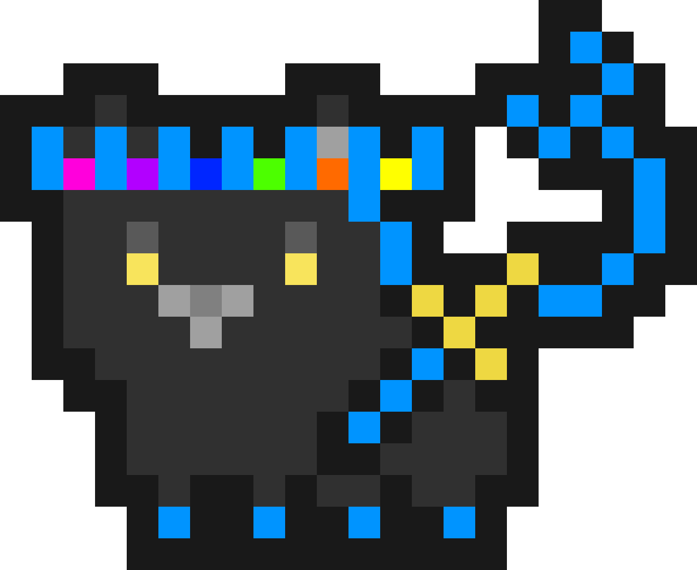
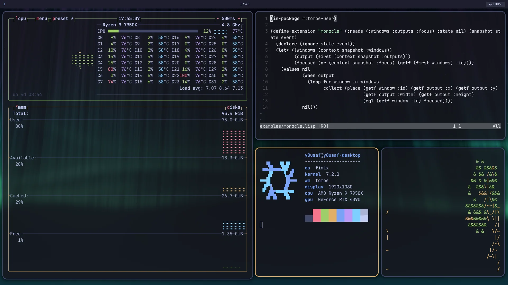
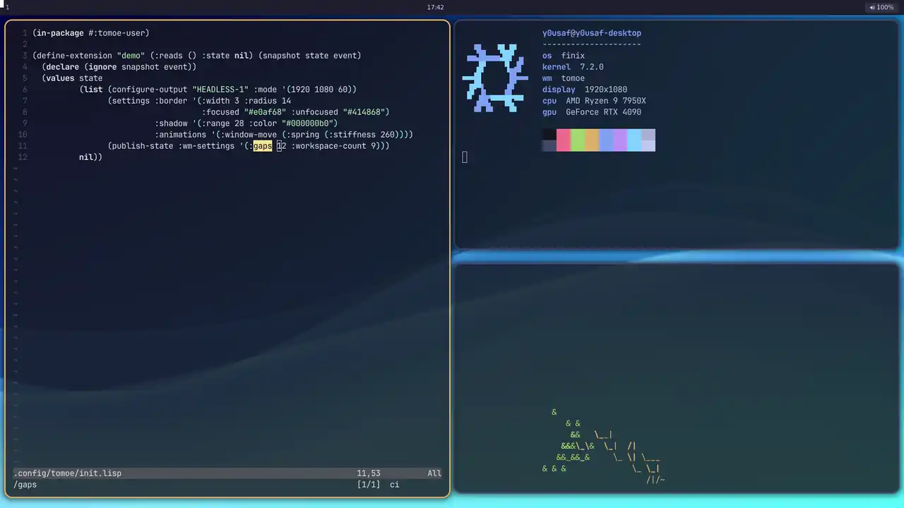

<p align="center"></p>
<br clear="both">

**Tomoe** (巴, after Tomoe, my beloved cat) is a Wayland compositor whose
window manager, bar and wallpaper are Common Lisp you can rewrite while it runs.

It is not a desktop environment. It won't log you in, start your system
services or hide its decisions behind a settings app. You start it from a
terminal, it leaves systemd alone, and every choice it makes is a Lisp file you
can read, replace or delete.

<p align="center"></p>

## Why you might like it

- **Your desktop is a program.** Tiling, keybindings, the bar, the wallpaper
  picker: each is a small extension. The shipped window manager uses the same
  public API your config does, and Tomoe has no special case for it.
- **Change it while it runs.** Save a file and Tomoe picks it up within
  half a second. Mount a different window manager, try it, unmount it:
  your windows stay open the whole time.
- **Mistakes don't take you down.** A file that fails to load leaves the last
  good version running and tells you what broke. `--bare` starts with no policy
  at all and is still a working compositor.
- **Unmount means gone.** An extension owns what it declares: placements,
  bindings, panels, processes, watched files. Unmount it and all of that goes
  with it.
- **One executable.** SBCL with Tomoe's own C core for Wayland, rendering and
  input; no wlroots. It has a built-in X11 bridge (Xwayland from your `PATH`),
  a notification server and a screencast portal. The default terminal and
  launcher bindings run `foot` and `fuzzel` from your `PATH`.

## Try it

You need Linux 6.9 or newer and [Nix](https://nixos.org/download) with flakes.

```sh
nix run github:y0usaf/tomoe
```

Inside another Wayland session Tomoe opens as a window, which is the easiest
way to look around. From a TTY it takes over the screen. The first run builds
Tomoe and a few patched dependencies, so give it a while.

| Keys | What they do |
| --- | --- |
| Super+Return | Open a terminal |
| Super+d | Open the launcher |
| Super+j, Super+k | Focus the next or previous window |
| Super+f | Toggle fullscreen |
| Super+1 … 9 | Switch workspace |
| Super+Shift+1 … 9 | Send the focused window to a workspace |
| Super+q | Close the focused window |
| Super+drag | Move a window with the left button, resize it with the right |
| Super+Shift+/ | Show every binding |
| Super+Shift+e | Quit, after asking |

The default layout tiles each workspace by halving the remaining space, with
an eight-pixel gap.

## Make it yours

Tomoe loads `~/.config/tomoe/init.lisp` at startup and reloads it whenever you
save. An extension is one function: it receives a snapshot of the desktop, its
own state and the event that woke it, and returns its new state and the effects
it wants. This one rounds the corners and widens the gaps:

```lisp
(in-package #:tomoe-user)

(define-extension "look" (:reads ()) (snapshot state event)
  (declare (ignore snapshot event))
  (values state
          (list (settings :border '(:radius 10 :focused "#89b4fa"))
                (publish-state :wm-settings '(:gaps 16)))
          nil))
```

Change a number, save, and the windows move:

<p align="center"></p>

A whole window manager fits on a screen. This is
[`examples/monocle.lisp`](examples/monocle.lisp), which shows only the focused
window:

```lisp
(in-package #:tomoe-user)

(define-extension "monocle" (:reads (:windows :outputs :focus) :state nil) (snapshot state event)
  (declare (ignore state event))
  (let* ((windows (context snapshot :windows))
         (output (first (context snapshot :outputs)))
         (focused (or (context snapshot :focus) (getf (first windows) :id))))
    (values nil
            (when output
              (loop for window in windows
                    collect (place (getf window :id) (getf output :x) (getf output :y)
                                   (getf output :width) (getf output :height)
                                   (eql (getf window :id) focused))))
            nil)))
```

Terminals that Tomoe starts have `tomoe` on their `PATH`, and it talks to the
running compositor. From a checkout of this repository, put monocle on top of
the tiling, then take it away again:

```sh
tomoe mount "$PWD/examples/monocle.lisp"
tomoe unmount monocle
```

No window restarts. `tomoe inspect` prints everything the compositor knows,
from windows and outputs to each extension's state and last error.

`tomoe frames` prints each output's frame counters, what a composition costs it
(`:cost-ns`), the vblanks it missed (`:missed`) and its frame clock, and
`tomoe memory` the heap and buffer use. A quiet scene collects the Lisp heap and
hands the dead generations and the free pages of the native heap back to the
system, so an idle desktop keeps only what it is using; `tests/memory.py` mounts
the shipping policy and a tiled scene at one, ten and fifty windows and fails if
that footprint or the longest collection grows past the bound it states.
`tomoe timings` prints the latency Tomoe spends on its own work, in
nanoseconds: pointer and drag motion to the frame carrying it, a key press to the
transaction applying it, the wait between an input and its frame, each phase of a
policy transaction and of a frame, and a client commit to its frame. It also prints
the same inputs measured to the vblank that presented them, so `latch-input` is
how old the newest input was when the frame took it and `present-input` is how long
every input waited for the display. The samples are kept only when the compositor
starts with
`TOMOE_TIMINGS=1`, so the default pays a branch per sample point and nothing
else; `tests/timing.py` drives one event per frame through it for a repeatable
table, alongside the bytes each sample path consed and every frame longer than a
refresh, tagged with the collection it overlapped. `tests/trace.py` mounts a set
of scripted policies and records the order every reducer was dispatched in, the
one-shot commands they emitted and the layout and context every materialization
settled on, then compares that record with `tests/trace.golden`: dependency
chains, rule replacement, deferred deliveries, mount and unmount ownership, a
failing reducer, a dependency cycle, eight windows placed by one grid extension,
a delayed interval and a source swapped on disk all have to reproduce it exactly.

Every output keeps a frame clock. It records what its compositions cost from the
moment a repaint starts to the moment the commit is submitted, keeps the 99th
percentile of that histogram, and adds a slack that grows whenever a frame lands
a vblank late and decays while none do, so a missed frame widens the deadline
instead of turning into the steady state. A repaint is armed for the next vblank
minus that prediction, which leaves the whole period free for input: the frame
takes the newest pointer position and the newest client buffers and still
reaches the same vblank. When the prediction says the next vblank cannot be met,
the repaint waits for the one after it and carries the input that arrived in
between, rather than composing into a miss. An idle output arms nothing.
`tests/frameclock.py` drives vkms with a 1000 Hz pointer and a 500 Hz client,
with and without `TOMOE_FRAME_CLOCK=0` for comparison, and asserts the drop.

The compositor thread asks for round-robin realtime priority once it is running,
so a busy desktop cannot delay Tomoe's own frame. Without `CAP_SYS_NICE` (or an
`rtprio` limit in `limits.conf`) the kernel refuses and Tomoe stays at normal
priority; `TOMOE_RT_PRIORITY=0` skips the attempt. Processes Tomoe starts stay at
normal priority, because the policy is set with reset-on-fork.

## One table of commands

Everything the desktop can do is a named command with typed arguments, and
every way of asking for it goes through that one table: a key binding, the
`tomoe` command line, and the JSON socket. An extension declares a command
beside the bindings that use it:

```lisp
(in-package #:tomoe-user)

(define-extension "quick-focus" (:reads (:windows :command) :state nil)
    (snapshot state event)
  (let ((ids (mapcar (lambda (window) (getf window :id)) (context snapshot :windows))))
    (values nil
            (list (define-command "first-window"
                    :description "Focus the first window.")
                  (bind-key '(:mod) "F1" "first-window"))
            (when (and (eq (getf event :type) :command) ids)
              (list (focus (first ids)))))))
```

`define-command` takes a name, one line of description and typed `:arguments`:
`:window` and `:output` default to the focused window and its output, and are
checked to still exist; `:workspace` is 1 through the owner's `:maximum` (the
shipped window manager passes its real workspace count, 9 by default); the rest
are `:integer`, `:string`, `:argv`, `:boolean` and `:keyword` (with `:values`). A binding names
a command, or carries arguments with `(invoke ...)`:

```lisp
(bind-key '(:mod) "q" "close-window")
(bind-key '(:mod) "1" (invoke "switch-workspace" :workspace 1))
```

`tomoe commands` prints every command with its arguments as JSON, so an agent
can find its way around without reading Lisp:

```sh
tomoe commands
tomoe command focus-window window=42
tomoe command move-window-to-workspace window=42 workspace=3
tomoe command close-window
tomoe command switch-workspace workspace=99   # {"error":"No workspace 99."}, exit 1
```

`tomoe command` prints the values the command ran with, which is how you learn
which window "the focused one" meant. The same table answers on the JSON
socket: `{"method": "commands"}` lists it, and
`{"method": "command", "params": {"name": "focus-window", "arguments": {"window": 42}}}`
runs it. A command a config never binds is still reachable from both.

## Patch it while it runs

Two session commands, `patch` and `undo-patch`, change the running compositor
and put it back. A patch is an extension source: the same Lisp forms a config
file holds, loaded into its own package, mounted like any other source, and
remembered under a name so it can be withdrawn.

```sh
tomoe command patch file=/tmp/gap.lisp
tomoe command patch forms='(in-package #:tomoe-user) (define-extension ...)' name=gap
tomoe command undo-patch          # the most recent patch
tomoe command undo-patch name=gap
```

Undo unmounts the extensions the patch mounted and, because they mount the
ordinary way, the machinery that removes any source removes their effects too:
timers stop, supervised processes are signalled, watches, executions, shell
surfaces, bindings and commands go, and every effect it replaced exposes its
previous owner again. Any top-level `defun`, `defmacro`, `defvar` or
`defparameter` the patch made is restored to what it was before the patch, and
a patch that fails to load or whose reducer fails on mount is rejected with its
error, leaving the session exactly as it was.

What a patch can change is everything the extension interface can express:
window placement, drawing, settings, key and pointer bindings, commands,
published state, timers, processes and layer surfaces, plus the definitions it
replaces. What it cannot: the C core, the SBCL image, defstruct types,
classes, defconstants and other global state; arrays, hashes and files it
touches; symbols it interns into another package stay interned. Names are
unique per patch, so apply a corrected patch after undoing the old one, and a
patch that replaced definitions is undone before the patches applied after it,
because each one recorded the definitions it found. Patches are not watched
files — editing one does not reload it — and they survive a config reload
rather than being dropped with it.

## Examples

Each file in [`examples/`](examples) mounts on its own.

| File | What it does |
| --- | --- |
| [`monocle.lisp`](examples/monocle.lisp) | One window at a time, filling the screen |
| [`float.lisp`](examples/float.lisp) | Floating windows you move and resize with Super+drag |
| [`deck.lisp`](examples/deck.lisp) | Two columns, each a deck of windows you flip through with Alt+j and Alt+k |
| [`zoomer.lisp`](examples/zoomer.lisp) | An infinite canvas: zoom around the cursor, pan, and keep separate planes |
| [`workspaces.lisp`](examples/workspaces.lisp) | Nine tag-style workspaces |
| [`inactive.lisp`](examples/inactive.lisp) | Hyprland's `inactive_opacity` and `dim_inactive`: the unfocused window is dimmed and translucent |
| [`focus-flash.lisp`](examples/focus-flash.lisp) | A hyprfocus-style pulse: the window that gains focus shrinks, flashes and springs back |
| [`close-fade.lisp`](examples/close-fade.lisp) | A niri-style close: the window keeps its last frame, shrinking and fading out |
| [`workspace-spring.lisp`](examples/workspace-spring.lisp) | Three workspaces where the arriving window springs in as the old one leaves |
| [`special.lisp`](examples/special.lisp) | Scratchpads that pop up over the tiling |
| [`layer-inset.lisp`](examples/layer-inset.lisp) | Tiling that makes room for panels |
| [`headset.lisp`](examples/headset.lisp) | Two virtual outputs in place of every monitor, for a headset that streams them |
| [`shader-wallpaper.lisp`](examples/shader-wallpaper.lisp) | Seven animated GLSL wallpapers; Super+Shift+b cycles them |
| [`cursor-trail.lisp`](examples/cursor-trail.lisp) | A fading pixel-grid cursor trail that costs only the cells it lights |
| [`drag-smear.lisp`](examples/drag-smear.lisp) | A moving window leaves a quantized smear of its own pixels and collapses once it stops |
| [`horosphere.lisp`](examples/horosphere.lisp) | Windows tiled on the squares of a hyperbolic {4,5} tiling in a Poincare disk, warped onto their curved tiles; a middle-button drag pans the plane |
| [`bar.lisp`](examples/bar.lisp) | A top bar with a clock and media and volume panels |
| [`shell.lisp`](examples/shell.lisp) | The smallest bar: a title and a click counter |
| [`battery.lisp`](examples/battery.lisp), [`network.lisp`](examples/network.lisp), [`media.lisp`](examples/media.lisp), [`tray.lisp`](examples/tray.lisp) | Indicators built on Tomoe's session services |

Animated shader backgrounds see the pointer's last 64 samples as `iTrail` (x, y,
age in seconds, 1) and `iTrailCount`, in the same coordinates as `iMouse`. A
sample is taken every 8 ms of the pointer's own event time, so a drag the loop
drains as one queued batch still draws the path it travelled, corners and all,
rather than the straight line between where it started and where it stopped.
A shader or a trail advances once per display refresh, timed at the instant its
frame is shown, so on a 240 Hz monitor it moves 240 times a second; `:fps`
defaults to 0, which means "follow the monitor", and a nonzero `:fps` only caps
that rate. `:idle SECONDS` stops drawing and ticking once the pointer has been
still for `SECONDS`, and pointer motion starts it again, so an idle overlay
costs no frames.

A bare `(:trail ...)` background draws that path itself, as squares of `:cell`
pixels lit for `:life` seconds and dimmed in `:steps` levels of `:color`,
stopping `:idle` seconds after the pointer rests. The compositor walks the cells
the samples crossed and lights only those, so following the pointer costs the
cells the trail actually covers instead of a full-screen shader over the
output, and the same samples drive it: the trail example is
`(:trail :cell 9 :life 0.35 :steps 4 :color #xb8e0ffff :idle 0.5)`.

A window can also be drawn through a shader of its own, over a deformable mesh
whose texture coordinates stay pinned to the window.
`(window-properties ID :shader PATH :shader-grid '(COLUMNS . ROWS)
:shader-margin PIXELS :shader-settle SECONDS)` renders that window's own
texture through `PATH`; every other window is untouched, and the effect costs
nothing while the window is still. The shader fills the area around the window
by `:shader-margin` pixels and defines
`vec4 mainImage(out vec4 color, in vec2 fragCoord)` or names another entry
point with `:shader-entry`. It samples the window texture as `tex`, converts
geometry coordinates to texture coordinates with `geo_to_tex` (a `mat3`), and
can read `v_uv` (geometry, 0-1 over the window), `v_tex` (the same point in
the texture), `v_local` (pixels in the mesh), `iBox` (the window's rectangle in
the mesh), `iResolution`, `progress` and `clamped_progress` (time since the
window last moved, over `:shader-settle`), `random_seed`, `iTime`, `iFrame`,
`iDrag` (1 while this window is being dragged), the pointer trail above, and
`iPath`, the window's own recent movement as `(x, y, age, 1)` displacements in
mesh pixels with `iPathCount`; a shader can therefore react to any move, from a
drag to a layout change or a workspace switch, not just pointer input.
A vertex function `vec2 warp(vec2 grid)` bends the mesh, and `tex_prev`,
`tex_next` and the `curr_geo_to_*_geo` matrices are reserved for resize
effects. Shaders written for niri's open, close and resize animations run
unchanged with `:shader-entry "open_color"` (or `"close_color"`,
`"resize_color"`): the `niri_` uniforms are defined in terms of the ones above,
though the previous and next textures are the current texture until Tomoe
feeds a resize path. The compositor keeps drawing while a window with a shader
settles after moving, then goes quiet again.

A window does not have to be a rectangle. `(window-properties ID :mesh POSITIONS
:mesh-grid '(COLUMNS . ROWS))` draws it on a deformed grid instead: POSITIONS is
`(COLUMNS + 1) * (ROWS + 1)` pairs of X Y pixels relative to the corner the
window was placed at, row 0 on its top edge, and grid vertex `(0, 0)` holding
the pixel that shows the window's own top-left corner. The grid is stretched
onto that surface like a net, so a layout can bend a window into any shape it
likes, and the mesh costs nothing once the window stops moving. Pointer input
follows the same grid: the compositor maps a screen point back through the
triangle it falls in, so a click on a warped window lands on the pixel it is
drawn under, and a window with a mesh gives up its box border, shadow and
direct-scanout candidacy because its box is only the frame the grid was
described in. [`horosphere.lisp`](examples/horosphere.lisp) uses that to lay
windows on a hyperbolic tiling and pan the plane with a Mobius translation.

Output tools such as `wlr-randr` can query and configure every connected head,
including disabled outputs, through `zwlr_output_manager_v1` version 4. Mode,
position, scale, transform and adaptive-sync changes are tested as one transaction;
`wlr-randr --dryrun` validates without applying. Accepted settings become the
output baseline, while later explicit `configure-output` effects can override it.

## How it fits together

SBCL runs the policy. A C core linked into the same executable speaks Wayland
through libwayland-server, renders with EGL and GLES2 on GBM, and drives
DRM/KMS, libinput and libseat; it can also run nested in another compositor or
headless. Extensions never touch native state. They return effects, the runtime
settles every extension's effects into one transaction, and only then does the
native side apply it. A broken extension therefore can't leave the screen
half-updated, and because every effect has an owner, unmounting an extension
takes its effects with it. Settling a transaction rebuilds the context from the
current effects rather than editing the last one, but it keeps the last rebuild
while every accepted reducer result is the same as the one already folded into
it, and a transaction whose event changes no window, layer, output or client
geometry starts from the context the last commit settled on instead of folding
every effect again, which is most of the work a pointer or key event would
otherwise repeat.

Sandbox launchers can register private Wayland listening sockets with
`wp_security_context_manager_v1`, attaching sandbox engine, application and
instance identities before committing. Connections through these sockets can
create normal application surfaces, but cannot bind capture, desktop control,
input injection, global shortcut, output management or nested security-context
globals, even using global names learned outside the sandbox. Closing the
launcher’s lifetime FD stops new connections without disconnecting existing
clients; destroying the protocol object or launcher connection does not stop a
committed listener. This only restricts Wayland connections routed through the
registered socket; the launcher must isolate the main Wayland and Tomoe control
sockets and other host access itself.

## Documentation

- [Running Tomoe](docs/running.md): backends, flags, the default desktop, X11 and D-Bus
- [Outputs](docs/outputs.md): modes, scale, placement, mirroring, VRR, colour profiles and virtual outputs
- [Writing extensions](docs/extensions.md): the API, settings, lifecycle and live reload
- [Shell surfaces](docs/shell.md): bars, panels, menus and wallpapers drawn by Tomoe
- [Session services](docs/services.md): notifications, media, battery, backlight, sounds, network and tray
- [Window rules](docs/rules.md): properties for windows that match
- [Control and IPC](docs/control.md): the `tomoe` command and the JSON IPC
- [Internals](docs/internals.md): architecture, source map, protocols and limits

## Status

Tomoe is young, and 0.1 is its first release. Expect the API to move.

- It is my daily desktop on an NVIDIA RTX 4090, running on DRM from a TTY,
  and it runs on an AMD Framework laptop too. Other GPUs get less testing.
- Shaders are compiled first by a short-lived copy of Tomoe, so the driver's GLSL
  compiler never runs inside the compositor (NVIDIA keeps about 50 MB of compiler
  heap for the life of a process that compiles once). User shaders are remembered
  in `$XDG_CACHE_HOME/tomoe/shaders` and warmed before the next session starts.
- Clients can pace queued commits with `wp_fifo_v1`: barriers retain each update
  through the next output frame boundary, including direct scanout. Synchronized
  subsurfaces ignore FIFO waits as required by the protocol.
- Commit timestamps (`wp_commit_timing_v1`) are not advertised. Honoring them
  atomically needs shared readiness for synchronized parent/child transactions;
  the current queue applies parent state before releasing child caches.
- Applications can select themed cursor shapes, including text, resize and drag
  cursors, through `wp_cursor_shape_manager_v1`.
- Touchpad swipe, pinch and hold gestures are forwarded to the pointer-focused
  application through `zwp_pointer_gestures_v1`; focus loss cancels the gesture.
- Input methods use text-input-v3 and input-method-v2: focused text fields,
  surrounding text, preedit/commit/delete, candidate popups and keyboard grabs.
  A private headless end-to-end check exercises a minimal Wayland IME; toolkit
  support still depends on the application's text-input protocol support.
- Focused clients can inhibit compositor shortcuts with
  keyboard-shortcuts-inhibit-v1; focus loss or destruction restores bindings.
  VT switching remains compositor-controlled.
- Touch and tablets are not supported yet, and shell surfaces cannot take
  keyboard focus.
  Tablet support needs a separate device/tool lifecycle, proximity focus and
  tool cursors: the current input core accepts only keyboard/pointer devices
  and owns one pointer focus and cursor. No tablet global is advertised.
- Extensions are trusted code. They run inside the compositor with your
  permissions.
- Clients can use single-pixel buffers with viewporter for solid-colour surfaces.
- Per-surface alpha multipliers are committed atomically with surface state and
  affect normal rendering, cursors, cursor metadata, and captures. Non-identity
  multipliers disable direct scanout and hardware cursor bypasses.
- Direct scanout engages while one opaque window covers an output exactly and
  nothing paints above it. A full screen window then goes straight to the
  display; a bar, notification, menu, drag icon or a pointer whose cursor
  composites instead. Shell surfaces that draw nothing, and shader overlays that
  are idle, leave scanout alone. The `scanout` field of `tomoe frames` reports
  which output currently scans out.
- Overlay planes carry the topmost windows that nothing paints above, at their
  own position and size, when the client draws into a dma-buf that maps one to
  one onto the output, and the cursor rides on the cursor plane. Only what the
  planes do not cover is composited, each assignment is validated by an atomic
  test commit before it is used, and a rejected assignment falls back to
  compositing the whole output; the frame is identical either way. The `planes`
  field of `tomoe frames` counts the windows on overlay planes and `deferrals`
  counts commits the kernel refused because a flip was still outstanding.
- A window's own opacity, tint, scale, rotation and translation are window state:
  `window-properties` sets them, and each eases towards its new value with the
  matching `:animations` setting. The compositor animates the transitions it sees
  for itself too, `:window-open`, `:window-close`, `:window-move`,
  `:window-resize`, `:window-switch` and `:window-view`, each a spring or an ease
  set once. Nothing animates while nothing changes, and a non-identity state
  keeps that window out of direct scanout.
- Committed content-type hints are available to window policy as `:content-type`
  (`:none`, `:photo`, `:video`, or `:game`); they do not force a rendering policy.
- Toplevel tags and translated descriptions are available as `:tag` and
  `:description` in window snapshots and rule predicates.
- Dialog and modal hints are exposed as `:dialog`, `:modal`, and `:parent`.
  Parent unmap/destruction reparents children; parentless dialogs have no effect.
  Clients retain responsibility for filtering input to modal parents.
- System bell requests play the owned `:bell` sound through the existing sound
  service, for example `(sound :bell "/path/to/bell.wav")`. Without an owner,
  bells are silent, just like the other configurable sound events.

Bug reports, questions and odd setups are welcome in the
[issues](https://github.com/y0usaf/tomoe/issues).

## Development

```sh
nix build          # the package
nix build .#znver4 # the same code with -march/-mtune=znver4 for a Zen 4 host
nix flake check    # two KVM tests (headless suites, kms); needs /dev/kvm
nix develop -c ./dev.sh --backend nested   # run from source
```

The package takes `{ cpu ? "", opt ? "-O2", lto ? false }`; the C core is built at
`opt` with `-flto` when `lto` is set, and `cpu` adds `-march`/`-mtune` for that
one machine. `make OPT= CPU= LTO=` overrides the same three knobs from a checkout.

## License

[AGPL-3.0](LICENSE).
